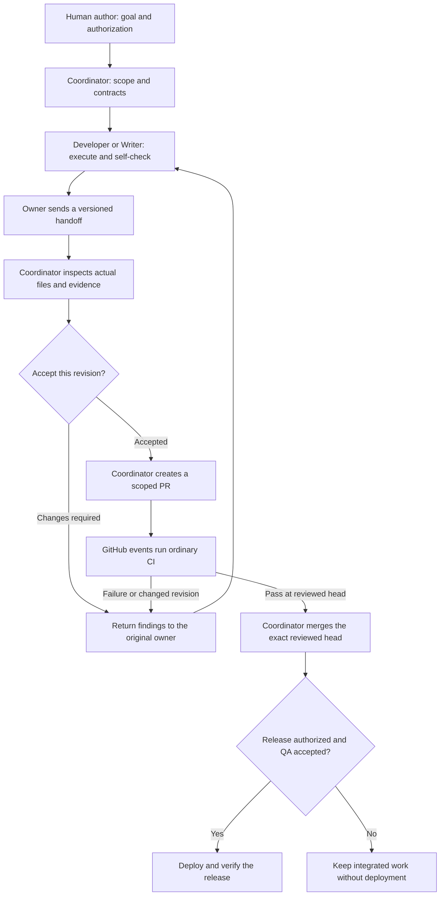

# Beyond the Frontend: It Works. Now What?

**《前端往后看：能跑，然后呢？》**

An evolving engineering book for Junior–Senior **Full-stack + AI Product Engineers**, connecting user goals, frontend design systems, backend/data architecture, reliable delivery and AI products through everyday product decisions.

**By Jason Zhang · Created with AI assistance throughout planning, writing and development.**

Junior, mid-level and senior readers share the same explanations: foundational mechanisms, concrete engineering examples and optional deeper trade-offs that can be read selectively. Some experience building pages, APIs or data processing helps; knowing every layer in advance is not required. Engineers entering from frontend or another specialty can follow the connections across a complete product. These are reading paths, not a promise of a job level or promotion.

## First-edition direction

The first edition connects eight parts: **product goals and the full-stack architecture map; frontend Design Systems and product interaction; APIs, backend boundaries and external integrations; databases, search and data flow; asynchronous work, traffic and reliability; cloud, testing and delivery; observability, debugging and recovery; AI product architecture and AI-assisted development**. The [detailed outline](book/planning/outline.md) owns chapter boundaries, ordering and coverage; this summary is not a second table of contents. Direction approval does not imply that chapters, research or manuscripts are completed or reviewed.

**AI product architecture is core reading.** It includes deciding whether AI helps a user task, controlled model integration, context and retrieval, workflows/tools, permissions, evaluation and quality/latency/cost trade-offs. Coding AI is a separate development-and-delivery thread: scoping work, providing context/contracts, reviewing changes and verifying releases. Teaching these topics does not mean this reading website runs model inference or embedded AI chat.

DevOps and data coverage supports delivering and maintaining a product; specialized platform/data volumes can be considered later. Explanations combine theory, original examples and conditional choices, with security, accessibility, testing, observability and performance woven through the relevant parts. Connected cases explain decisions rather than impose a capstone assignment. Training models, GPU/inference infrastructure and full specialist data-platform courses are outside the first-edition main line; detailed depth and optional extensions belong in the outline.

## What is available

- **In main:** an English-default bilingual website foundation, strict TypeScript and cloud-verified CI. Home/index routes are `/`, `/read/`, `/zh/` and `/zh/read/`, with a bilingual static 404.
- **Reviewed writing:** Chinese opening and shared-foundations drafts. Browser Fundamentals has an accepted research/outline gate, not a manuscript. These documents are in the repository; the website does not render chapters yet.
- **Preserved separately:** Design Tokens and Day/Night Themes has local implementation/build evidence in an unaccepted checkpoint. Independent browser acceptance and integration remain open.
- **Documentation:** the English project documentation and delivery history merged through [PR #7](https://github.com/HAIXIN-ZHANG/beyond-the-frontend/pull/7); agent workflow/onboarding followed in [PR #8](https://github.com/HAIXIN-ZHANG/beyond-the-frontend/pull/8). The [coordination board](docs/coordination.md) owns current assignments and execution holds; this introduction is not a work queue.
- **Online reading:** no verified public reading URL yet. GitHub Pages is authorized after code/content/QA acceptance, but has not been deployed. Search, audio and AI question cards are not available features.

The audience and eight-part direction are confirmed; detailed chapter splits remain planning proposals until their relevant review. An outline is not a complete or approved manuscript. `TBU` means unresolved or to be updated, never delivered. See [Development History](docs/development-history.md) for evidence and limits.

## Explore the project

| Start here | Purpose |
| --- | --- |
| [Project vision](docs/project-vision.md) | Audience, editorial direction, content map and intended reading experience |
| [Roadmap](docs/roadmap.md) | Future scope, priorities and acceptance gates |
| [Chinese stage summary](docs/stage-summary.zh-CN.md) | A single concise Chinese status summary |
| [Development History](docs/development-history.md) | Past and current outcomes, decision changes and reviewed evidence |
| [Developer guide](site/DEVELOPMENT.md) | Commands and behavior actually available on main |
| [Agent entry](AGENTS.md) | Short startup path to an explicitly assigned role, current board and task brief |

The [detailed book outline](book/planning/outline.md) owns content planning under the confirmed direction; its individual writing gates remain separate. Manuscripts, planning, process records and the website are different deliverables; committing a document does not publish it as a chapter.

## How this project is built with AI

Jason Zhang, the human author, sets the goals, reader needs, scope, key choices and authorization. AI helps with research, drafting, design, implementation and verification. The roles have explicit responsibilities:

| Role | Responsibility |
| --- | --- |
| Human author | Set direction, decide material trade-offs and authorize work/publication |
| Coordinator/Reviewer | Define architecture/contracts, assign bounded work, inspect actual deliverables, return revisions and manage integration |
| Developer | Implement assigned website/tooling or technical documents, run checks and report actual evidence/limits |
| Writer | Research and outline first, revise after analysis review, then draft prose for a separate manuscript review |

Coordinator reviews and records decisions; it does not write product code, prose or formal implementation explanations for the executors. The implementer does not approve or merge its own work. The chapter [analysis/manuscript gates](book/planning/chapter-workflow.md) remain separate.



Owners send explicit messages and paths to the existing chats. Coordinator actively assigns and reviews work; the chats do not continuously watch files. GitHub PR/push events automatically run CI, while acceptance of technical and editorial choices remains a recorded judgment. There is no unattended orchestration engine, standing cloud AI reviewer or AI backend behind the reading website.

Shared Markdown preserves accepted contracts, handoffs and feedback rather than raw private chat transcripts. Working branches/worktrees keep concurrent scopes separate. Start an agent through [AGENTS](AGENTS.md) and the explicit [Coordinator/Reviewer](docs/coordinator-role.md), [Writer](docs/writer-sync-prompt.md) or [Developer](docs/developer-sync-prompt.md) guide. See [collaboration](docs/collaboration.md) for the detailed rules and [real decision examples](docs/development-history.md#decision-evolution) for how the process changed the work. The board owns current state, one task brief/handoff owns execution evidence, and review records own exact-revision judgments; archives are optional historical references.

## Run the current website

Main uses Next.js static export, React, strict TypeScript and npm. JavaScript remains at documented tooling boundaries. From the repository root, with Node.js 24 and npm 11:

```sh
npm ci
npm run dev
```

[The developer guide](site/DEVELOPMENT.md) covers checks, root/Pages builds and known limits. Panda codegen commands belong to the separate checkpoint; they are not commands available on main.

## Reading direction and design

The book starts from user tasks and success criteria, introduces precise mechanisms through familiar examples, and connects interface behavior to APIs, records, background work, delivery/recovery and AI capabilities. Architecture choices describe combinable dimensions rather than a ladder from synchronous to asynchronous, serverless or high-concurrency systems. Technology choices are contextual trade-offs, not a list everyone must adopt. Examples are teaching scenarios, not an employer's systems or evidence of production scale.

**Design references:** [Tokens](https://www.figma.com/design/3GYIfJz8xSPGx3AE3RRkKi?node-id=40-12) · [Components](https://www.figma.com/design/3GYIfJz8xSPGx3AE3RRkKi?node-id=22-135) · [Page Designs](https://www.figma.com/design/3GYIfJz8xSPGx3AE3RRkKi?node-id=2-2). Reading, responsive and Day/Night views share one page. The [design handoff](docs/design/reading-experience-v1.md) distinguishes design evidence from code/browser acceptance.

The planned AI reading feature is a small set of inspectable, copyable questions and selected context for the reader's own tools. Choosing that direction instead of an embedded paid chat service is a planning decision, not an implemented integration. Audio is a separate, unperformed publishing experiment. Neither plan is an execution assignment.

## Feedback, sources and access

[Open an issue](https://github.com/HAIXIN-ZHANG/beyond-the-frontend/issues) with a question, correction or relevant source. Public access permits reading and proposed changes, not pushing or merging into the original repository or editing the Figma source. See [SECURITY.md](SECURITY.md) and the [dated access baseline](docs/security/access-policy.md).

Technical claims should identify primary sources, conditions and what was actually checked. AI-generated explanations are not evidence by themselves. Review acceptance, cloud checks, merge and deployment are distinct records.

**Licensing and contribution terms: TBU.** Content/code licenses have not been selected; public availability is not a blanket reuse license. Third-party materials retain their own terms. Formal contribution rules must be settled before inviting reusable submissions.

## Inspiration

- [The Engineering Handbook](https://github.com/handbook-academy/engineering-handbook): organizing substantial engineering reading around systems and technical decisions.
- [HowToLiveBetter](https://github.com/eternity4719/HowToLiveBetter): approachable, searchable, continuously maintained public knowledge.

These acknowledge inspiration, not affiliation, endorsement or reuse of their code, prose or diagrams.
